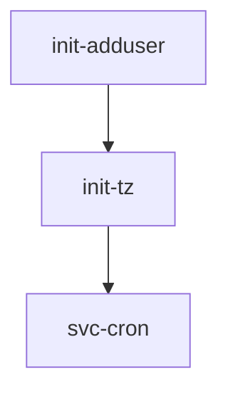

# alpine-base

A minimal Alpine Linux base image with [s6-overlay v3](https://github.com/just-containers/s6-overlay) as PID 1, designed to be the root of the `nforceroh` image portfolio: derived images inherit its init system, user bootstrap, timezone handling, and tooling instead of re-implementing them.

Published to `ghcr.io/nforceroh/alpine-base` for `linux/amd64` and `linux/arm64`.

## Architecture

The image is a thin, layered stack:

```
alpine:3.24 (pinned base)
└── apk packages        tar, xz, shadow, jq, curl, openssl, bash, tzdata, ...
└── s6-overlay v3       downloaded at build time, extracted to /
└── /etc/s6-overlay     s6-rc.d service tree (COPY'd from content/)
└── ENTRYPOINT /init    s6-overlay supervises everything
```

### s6-rc service tree

Three services are compiled into the user bundle (`user/contents.d`), with dependency ordering enforced by `dependencies.d` files:



| Service | Type | Purpose |
|---|---|---|
| `init-adduser` | oneshot | Creates/adopts the app user, creates `/app`, `/config`, `/defaults`, and chowns them |
| `init-tz` | oneshot | Validates `TZ` against `/usr/share/zoneinfo`, writes `/etc/timezone` and symlinks `/etc/localtime` |
| `svc-cron` | longrun | Runs busybox `crond -f` when `ENABLE_CRON=true` and a crontab exists; otherwise parks with `sleep infinity` |

### User bootstrap (`init-adduser`)

The service resolves the app user from `PUID`/`PGID` (defaults `3001`/`3000`, user `abc`):

1. If a user already exists at `$PUID` (baked in by a derived image, e.g. `relayer`, `dcc`), it is **adopted** rather than collided with. Without this, `addgroup -g $PGID` fails with "gid in use", `adduser -G` fails with "unknown group", and the chown targets a user that was never created.
2. Otherwise the group and user are created (non-fatally) and `/app`, `/config`, `/defaults` are created and chowned — the chown is the whole point of the service and fails loudly on error.

Derived images can override the user name with `APP_USER`; a baked user at `$PUID` always wins.

### Timezone (`init-tz`)

Falls back to `America/New_York` if `TZ` is not a valid zoneinfo path, and only rewrites `/etc/timezone` + `/etc/localtime` when they differ from the requested zone.

## Environment variables

| Variable | Default | Description |
|---|---|---|
| `PUID` | `3001` | UID of the app user created/adopted at boot |
| `PGID` | `3000` | GID of the app user's group |
| `APP_USER` | `abc` | Name of the app user (ignored when a user already exists at `$PUID`) |
| `TZ` | `America/New_York` | Container timezone; invalid values fall back to the default |
| `ENABLE_CRON` | `false` | Set to `true` to start busybox `crond` |
| `S6_LOGGING` | `1` | s6-overlay logging verbosity |
| `S6_VERBOSITY` | `1` | s6-overlay output verbosity |
| `S6_FIX_ATTRS_HIDDEN` | `1` | Fix permissions on hidden s6 directories |
| `S6_KILL_FINISH_MAXTIME` | `300000` | Max ms s6 waits for finish scripts on shutdown |
| `S6_CMD_WAIT_FOR_SERVICES_MAXTIME` | `0` | Wait indefinitely for services before running CMD |

## Build arguments

| ARG | Default | Description |
|---|---|---|
| `BUILD_DATE` | `now` | Stamp baked into the `org.label-schema.build-date` label |
| `VERSION` | `unknown` | Image version, stamped into labels |
| `S6_OVERLAY_VERSION` | `3.2.3.2` | s6-overlay release to download |
| `TARGETARCH` | `amd64` | Set by Docker on multi-platform builds; mapped to the s6-overlay arch (`amd64→x86_64`, `arm64→aarch64`, `arm→armhf`, `386→i686`); unknown values fail the build |

## Usage

As a base for derived images:

```dockerfile
FROM ghcr.io/nforceroh/alpine-base:3.24
# add packages, copy app code, drop s6 services into /etc/s6-overlay/s6-rc.d/
```

Standalone (e.g. to poke at the environment):

```bash
docker run --rm -it -e PUID=1500 -e PGID=1500 -e TZ=Europe/Paris \
  ghcr.io/nforceroh/alpine-base:3.24
```

## Local build and test

```bash
make build   # builds ghcr.io/nforceroh/alpine-base:dev
make test    # builds, then runs tests/run_tests.sh smoke tests
```

The smoke harness covers: the s6 entrypoint and service database, default and `PUID`/`PGID`-driven user creation, the baked-user adoption regression (a user pre-created at `$PUID` must be adopted, not collided with), `/app`/`/config`/`/defaults` creation, `TZ` application, and presence of `jq`/`curl`/`openssl`/`bash`.

## CI

`.github/workflows/build.yaml` is a stub delegating to the shared reusable workflow in [nforceroh/.github](https://github.com/nforceroh/.github), which is the sole publisher. It builds `linux/amd64` + `linux/arm64`, tags `3.24`, publishes to GHCR on `main` and `v*` tags, and runs on a weekly schedule. Renovate config extends the shared `github>nforceroh/.github` preset.

## Layer contract

This is a base producer: any change to its layers (labels, ENV, packages, users, s6 tree) requires every derived image that inherits from it to be rebuilt and re-tested before the change is considered done.
